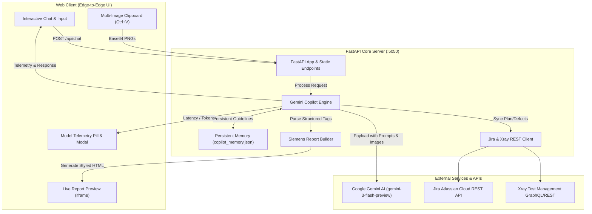

# 🏛️ Architecture & Technical Specification — Siemens SAT Report Copilot

## 1. System Overview

**Siemens SAT Report Copilot** is an enterprise-grade AI pair-programming and reporting platform engineered for System & Application Test (SAT) architects in Siemens eMobility. It bridges Jira & Xray Test Management with Google's Gemini 3 multimodal models, providing live interactive generation and surgical editing of executive engineering reports adhering strictly to the official Siemens Corporate Design Standard.

---

## 2. Core Components

### 2.1 Backend Server (`server.py`)
- **Framework:** FastAPI with Uvicorn ASGI server running on `127.0.0.1:5050`.
- **Endpoints:**
  - `GET /`: Serves the primary web interface (`web/index.html`).
  - `GET /api/state`: Returns the active project state (plan key, summary, executions, defects, custom sections, telemetry).
  - `GET /api/current_report`: Serves the rendered HTML report for the live preview iframe.
  - `POST /api/chat`: Handles conversational turns with text and multiple Base64-encoded screenshots. Returns assistant reply, updated state, and execution telemetry.
  - `POST /api/export_pdf`: Triggers headless Chrome rendering to produce executive PDF printouts.

### 2.2 Gemini Copilot Engine (`gemini_copilot.py`)
- **Role:** Acts as the Principal SAT Architect & Technical Lead.
- **Model Hierarchy & Fallbacks:**
  1. `gemini-3-flash-preview` (Primary: high reasoning, low latency, multimodal)
  2. `gemini-3.1-flash-lite`
  3. `gemini-3.5-flash`
  4. `gemini-flash-latest`
- **Dynamic Dual-Mode Intelligence:**
  - **Jira Mode:** Pulls live test executions, defect statuses, pass rates, and root causes from Jira/Xray.
  - **Custom Report Mode:** Detects ad-hoc engineering requests (field trials, interoperability tests, audits, meeting notes) and builds complete, tailored reports without forcing Jira plan structures.
- **Structured Tag Parser:**
  - `<CUSTOM_REPORT_JSON>`: Generates complete structured reports adapted to user prompts.
  - `<REPORT_HTML>`: Full HTML override for complete document transformations.
  - `<HTML_EDIT>`: Targeted search-and-replace patches for surgical document adjustments.
  - `<HIDE_ELEMENT>` / `<SHOW_ELEMENT>`: Toggles visibility for Hero banners, KPI cards, or specific sections.
  - `<EXECUTIVE_NOTE>`: Highlights engineering quality advisories directly under the KPI deck.
  - `<CUSTOM_SECTION>`: Inserts technical deep-dive sections into the document flow.
  - `<UPDATE_RECOMMENDATION>`: Updates formal release verdicts (`GO`, `CONDITIONAL GO`, `NO-GO`).

### 2.3 Report Builder Engine (`report_builder.py`)
- **Siemens Corporate Standard:** Enforces official typography (Segoe UI), color codes (Siemens Petrol `#009999`, Siemens Ink `#001b2e`, Accent `#00e5d0`), arc geometric header, metric cards, summary hero boxes, data tables, and quality callouts.
- **Functions:**
  - `render_html_report(state)`: Orchestrates the Jira SAT Executive Meeting Report.
  - `render_custom_report(custom_data, state)`: Dynamically generates custom reports from structured prompt specifications.
  - `clean_german_text(text)`: Translates residual German test terms into Siemens international English.

### 2.4 Web Interface (`web/index.html`)
- **Split-Screen Layout:** Left-side collapsible chat panel with live telemetry and multi-image attachments; right-side live iframe preview.
- **Telemetry Indicators:** Displays active AI model, latency (in seconds), input/output token counters, and status indicators for Jira, Xray, and Gemini.
- **Multi-Attachment Preview:** Supports `Ctrl+V` pasting of multiple screenshots with visual badge counters and thumbnail management.

---

## 3. Data Flow & Execution Lifecycle

1. **User Request:** Engineer enters a prompt (e.g., *"Cria um relatório técnico sobre a reunião de interoperabilidade em Seixal..."*) and pastes relevant oscilloscope or terminal screenshots.
2. **Intent Analysis:** Copilot assesses whether the prompt targets Jira plan synchronization or custom engineering synthesis.
3. **Prompt Construction:** Injects persistent guidelines (`copilot_memory.json`), current report layout, system rules, and user media into the Gemini payload.
4. **Model Execution & Telemetry:** Dispatches request to the Gemini API, tracks round-trip latency, and extracts token usage counters.
5. **Tag Execution:** Parses structured tags emitted by the model to mutate state and rebuild the HTML.
6. **Live Preview Update:** Pushes the generated report to the live preview iframe without page reload.
